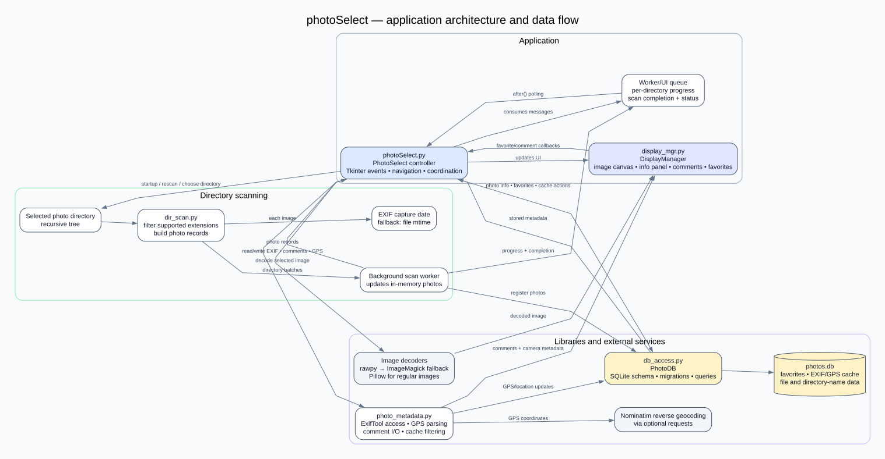

# photoSelect

`photoSelect` is a Tkinter photo browser. It recursively scans a directory,
then lets you browse supported photos in chronological order.

## Features

- Sorts photos by EXIF capture date, falling back to file modification time.
- Displays JPEG, GIF, and common RAW formats.
- Reads and writes image comments with ExifTool.
- Saves favorites and photo metadata in a `photos.db` SQLite database in the
  selected scan directory.
- Displays camera information, GPS data, and date/location details parsed
  from the photo's parent directory name.
- Can cache GPS coordinates from photo metadata and look up place names from
  those coordinates.

## Requirements

- Python 3.10 or newer
- Tkinter
- Pillow
- ExifTool, for EXIF dates, camera/GPS metadata, and comments
- ImageMagick, as a fallback for displaying RAW images

Optional:

- `rawpy` for RAW image decoding
- `requests` for the **Populate Location Cache** action

On Ubuntu/Debian, install the system packages and Python dependencies with:

```bash
sudo apt install python3-tk libimage-exiftool-perl imagemagick
python3 -m pip install Pillow
```

For optional features:

```bash
python3 -m pip install rawpy requests
```

## Usage

Run from the repository root:

```bash
python3 src/photoSelect.py
```

By default, the current directory is scanned recursively. To scan another
directory, pass `--in-dir` (relative to the current working directory, or an
absolute path):

```bash
python3 src/photoSelect.py --in-dir photos/2024
```

Use `--threads N` to scan up to `N` directories concurrently. Each worker
handles one directory at a time; the default is one scanning thread:

```bash
python3 src/photoSelect.py --in-dir photos/2024 --threads 4
```

You can also choose another directory from **File → Select Directory...**
while the application is running.

## Controls

| Key or action | Function |
|---|---|
| `←` / `→` | Previous / next photo |
| `Home` / `End` | First / last photo |
| `f` | Toggle favorite |
| Double-click or `Enter` on a photo in the tree | Open that photo |
| `r` | Rescan the current directory |
| `Esc` / `q` | Quit |

The display panel also provides a favorite button and a comment editor. Select
**Save Comment** to write the comment to the image file.

## Menus

- **File → Toggle Favorite (f)** - Toggle the current photo's favorite status.
- **File → Rescan Directory (r)** - Rescan the current scan directory.
- **File → Select Directory...** - Choose and scan a different directory.
- **File → Export** - Copy favorited photos to `exports/<scan-directory-name>`
  in the current working directory. Non-JPEG photos are converted to JPEG at
  their full available resolution without upscaling. The database `export_name`
  is used as the output filename, with the appropriate extension. The output
  directory is emptied before each export, including when there are no
  favorites. Exported photos are flat in that directory; favorites with
  duplicate output filenames cannot be exported together. RAW conversion uses
  `rawpy` when installed, otherwise ImageMagick.
- **Actions → Populate GPS Cache** - Read GPS coordinates from photo metadata
  and save them in the database.
- **Actions → Populate Location Cache** - Reverse-geocode cached GPS
  coordinates and save the resulting city and country. This requires
  `requests` and an internet connection.
- **Help → Controls** - Show the in-app control reference.

The information panel shows **User Supplied Data** (date, city, and details
parsed from the directory name) and **Camera Information** (camera model, file
date, GPS position, and cached GPS city and location).

## Directory names and metadata

The app recognizes parent directory names in the form
`YY_MM_DD[.number...]-Location` or `YY_MM_DD[.number...]_Location`. The year is
interpreted as 2000 plus `YY`. For example,
`26_02_04_MexicoCity_FridaKahlo` produces:

- Date: `2026-02-04`
- City: `Mexico City`
- Details: `Frida Kahlo`

The location is split at its first underscore. CamelCase words in the city and
details are separated with spaces. If the date or location cannot be parsed,
the corresponding user-supplied fields are left empty.

## Database

Each scan directory contains a `photos.db` SQLite database. Paths inside the
scan directory are stored relative to that directory. The `photos` table
contains:

| Column | Meaning |
|---|---|
| `path` | Photo path |
| `favorite` | Favorite flag |
| `gps_from_file` | GPS position read from the photo file |
| `city_from_gps` | City from reverse geocoding |
| `country_from_gps` | Country from reverse geocoding |
| `date_from_file` | File modification time stored in UTC |
| `date_from_name` | Date parsed from the parent directory name |
| `city_from_name` | City parsed from the parent directory name |
| `loc_details_from_name` | Location details parsed from the parent directory name |
| `export_name` | Date, country, city, location, and zero-padded directory sequence |
| `dir_sequence` | 1-based position by `date_from_file` within the photo's directory |

When browsing, photos are sorted by EXIF capture date when available, falling
back to file modification time. The separately displayed `date_from_file`
field is the file modification time stored in the database.

## Code layout

- `src/photoSelect.py` - Application controller and Tkinter interactions.
- `src/lib/display_mgr.py` - Image and information-panel display.
- `src/lib/dir_scan.py` - Directory traversal and image file-date detection.
- `src/lib/photo_metadata.py` - ExifTool access, GPS parsing, and geocoding.
- `src/lib/db_access.py` - SQLite storage and schema migrations.
- `src/lib/exports.py` - Favorite selection and photo export.

## Architecture



The editable Graphviz source is [`docs/photoSelect-architecture.dot`](docs/photoSelect-architecture.dot).

## License

This is a personal utility script.
